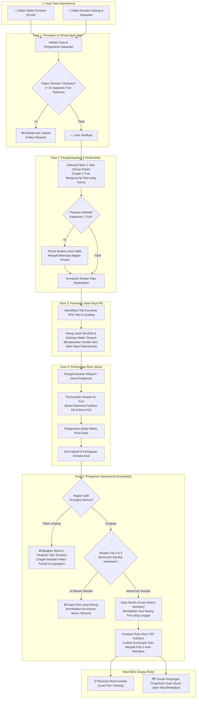

# Panduan Alur Operasional Sistem Dispatch Rute

## 1. Pendahuluan
Sistem Dispatch Rute Otomatis ini dirancang untuk menyusun rencana pengiriman harian secara cepat dan efisien. Sistem bertugas memproses data mentah berupa **daftar faktur pesanan (invoices)** dan **daftar armada truk yang tersedia hari ini**, lalu menyusun jadwal keberangkatan, pembagian muatan, dan urutan rute perjalanan untuk masing-masing armada. 

Tujuan utama dari sistem ini adalah memastikan seluruh armada muat secara maksimal, pengiriman tidak terlambat, dan rute perjalanan supir searah sehingga menghemat waktu dan bahan bakar.

---

## Diagram Alur Kerja Sistem (Flowchart)

Berikut adalah bagan visual alur perjalanan data dari input faktur hingga menjadi rute pengiriman siap jalan:

---

## 2. Fase 1: Persiapan & Penyaringan Data (Data Ingestion)
Sebelum rute dibuat, sistem perlu memastikan bahwa data yang masuk benar-benar valid dan masuk akal untuk dikirimkan.

- **Upload Data:** Sistem menerima daftar pesanan (faktur) dan mengecek armada yang tersedia, termasuk kapasitas kubikasi (volume) dan tonase berat maksimum masing-masing mobil.
- **Filter Faktur Siluman (Dummy / Exception):** Terkadang ada data pesanan yang tidak masuk akal atau bersifat *dummy* (misalnya pesanan yang ukurannya tiga kali lipat lebih besar dari truk paling besar di cabang). Sistem akan otomatis mendeteksi dan **menyisihkan (membuang)** faktur raksasa ini agar tidak merusak perhitungan rute armada lainnya.

---

## 3. Fase 2: Pengelompokan & Pemecahan (Preprocessing)
Pada tahap ini, sistem mengatur strategi agar proses pengiriman ke toko lebih praktis.

- **Penggabungan Faktur Toko (Group Payer):** Sangat sering terjadi satu pelanggan/toko memesan barang dalam beberapa faktur yang berbeda. Sistem pintar akan otomatis mengikat faktur-faktur ini menjadi **satu kesatuan**. Alasannya jelas: kita tidak ingin dua truk berbeda datang ke toko yang sama di hari yang sama, yang mana sangat tidak efisien.
- **Pemecahan Muatan Besar (Auto-Split):** Jika ada satu toko yang pesanannya sangat besar hingga tidak muat dimasukkan ke dalam truk terbesar kita sekalipun, sistem akan memecah pesanan tersebut ke dalam beberapa bagian. Dengan begitu, pesanan ini bisa diangkut oleh dua atau tiga truk yang berbeda secara logis tanpa membatalkan pengiriman.

---

## 4. Fase 3: Pemetaan Jalan Raya (Distance Matrix)
Sistem tidak menggunakan metode "tarik garis lurus" di peta untuk mengukur jarak. 
Sistem akan membaca titik koordinat toko dan menghubungi server peta khusus jalan raya untuk mendapatkan **jarak tempuh riil (dalam kilometer)** dan **estimasi waktu perjalanan** dengan mempertimbangkan jalur jalan sesungguhnya. Hal ini memastikan jadwal tiba di toko sangat akurat.

---

## 5. Fase 4: Perhitungan Rute Utama (Core Optimization)
Ini adalah "otak" dari sistem. Sistem akan mengelompokkan pesanan berdasarkan rute atau zona areanya, lalu mencocokkannya dengan armada yang ada.

- **Kapasitas Kendaraan Maksimal:** Sistem memastikan setiap truk diisi barang sebanyak-banyaknya tanpa melebihi batas kubikasi (M3) atau berat (KG) kendaraan.
- **Batasan Waktu Operasional:** Sistem menghitung lamanya perjalanan di jalan raya ditambah estimasi waktu bongkar muat di setiap toko, memastikan supir tidak bekerja melampaui batas waktu operasional (misalnya harus selesai sebelum malam).
- **Penempatan Rute Terbaik:** Sistem menguji ribuan kombinasi secara cepat untuk menentukan toko mana saja yang harus dikunjungi oleh Truk A, Truk B, dan seterusnya, guna mendapatkan efisiensi biaya paling maksimal.

---

## 6. Fase 5: Penyesuaian & Aturan Keselamatan Logistik (Post-Processing & Guardrails)
Setelah perhitungan dasar selesai, sistem akan menerapkan filter pengaman operasional untuk memastikan jadwal yang terbentuk benar-benar bisa dieksekusi di lapangan tanpa masalah.

- **Aturan Pengiriman Utuh (All-or-Nothing / Split Guardrail):**
  Apabila sebelumnya ada pesanan toko besar yang "dipecah" menjadi 3 bagian truk, namun ternyata hari itu jumlah truk kurang sehingga 1 bagian tidak kebagian mobil, maka **seluruh pesanan toko tersebut akan ditarik mundur (dibatalkan otomatis)**. Sistem mencegah terjadinya *pengiriman parsial (sebagian)* yang sering membuat proses penagihan (invoicing) menjadi sangat rumit di lapangan.
- **Evaluasi Tingkat Keterisian Truk (EPE Pruning):**
  Untuk keberangkatan pertama (Trip 1), sistem memaksa tingkat keterisian mobil cukup tinggi. Sedangkan untuk truk yang berangkat ritase kedua atau ketiga (Trip 2 & Trip 3), sistem menetapkan standar keterisian muatan yang wajib dipenuhi. Jika sebuah rute Trip 2 ternyata isinya sangat sedikit dan merugi, sistem akan otomatis mencopot rute tersebut dan mengembalikan fakturnya ke antrean pesanan belum terkirim.
- **Sapu Bersih Sisa Ruang (Cross-District Sweeper):**
  Jika ada truk yang ditugaskan ke area Timur namun ternyata muatannya masih longgar, sistem akan mencari pesanan kecil dari area lain yang searah atau belum dapat mobil, lalu "menyelipkan" pesanan tersebut ke dalam ruang kosong truk ini agar kapasitas terpakai 100%.
- **Perapian Urutan Jalan (Auto-TSP Polisher):**
  Sebagai langkah paling akhir, sistem menata kembali urutan kunjungan toko (Toko 1 -> Toko 2 -> Toko 3). Sistem memastikan agar truk berjalan dalam pola melingkar (*looping*) yang searah dan alami, mencegah supir mondar-mandir melewati jalan yang sama berkali-kali.

---

*Dengan seluruh tahapan di atas, sistem akan menghasilkan rekap rute final, yang dapat dicetak menjadi Surat Jalan / Load Plan untuk langsung diserahkan kepada tim gudang dan supir.*
