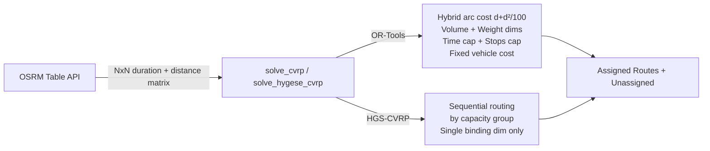

# CVRP Optimization Audit — Strategy Document

**Author**: Senior Operations Research Engineer  
**Codebase**: [cvrp_service.py](file:///c:/System%20Support/App/RouteManagement/cvrp_service.py)  
**Date**: 2026-06-18  
**Status**: Strategy Only — No Code Changes

---

## Executive Summary

After a thorough audit of the CVRP implementation (OR-Tools solver at [line 272](file:///c:/System%20Support/App/RouteManagement/cvrp_service.py#L272) and HGS-CVRP solver at [line 493](file:///c:/System%20Support/App/RouteManagement/cvrp_service.py#L493)), I have identified **6 concrete improvement areas** across the two requested pillars. The findings are organized from highest to lowest impact.

### Current Architecture at a Glance



---

# Pillar 1: Optimizing Fleet Assignment (Clustering)

## 1.1 Dual-Capacity Bin Packing

### Current State

| Aspect | OR-Tools | HGS-CVRP |
|---|---|---|
| Volume (m³) constraint | ✅ Hard dimension ([L344–350](file:///c:/System%20Support/App/RouteManagement/cvrp_service.py#L344-L350)) | ❌ Not enforced |
| Weight (kg) constraint | ✅ Hard dimension ([L353–359](file:///c:/System%20Support/App/RouteManagement/cvrp_service.py#L353-L359)) | ❌ Not enforced |
| Binding dimension selection | N/A (both enforced) | Only **one** dimension chosen at [L527](file:///c:/System%20Support/App/RouteManagement/cvrp_service.py#L527) |

### Gap Analysis

> [!CAUTION]
> **HGS uses only ONE capacity dimension.** At [line 527](file:///c:/System%20Support/App/RouteManagement/cvrp_service.py#L527), the code selects either m³ or kg as the binding constraint based on aggregate fleet load ratio. This means:
> - If m³ is the binding dimension, a vehicle could be loaded to 100% of its volume but **exceed its weight capacity by 30%** — the solver would never know.
> - The choice is global (fleet-wide). Individual vehicles where the *non-binding* dimension is actually tighter will be over-loaded silently.

**OR-Tools does NOT have this problem** — it registers both as separate hard dimensions. This is correct.

### Proposed Strategy

#### Strategy 1A: Post-HGS Feasibility Enforcement (Low effort, Medium impact)

After HGS returns its routes, add a **post-processing validation pass** that checks both dimensions and splits overloaded routes:

```
For each HGS route:
  1. Calculate actual m³ total AND kg total
  2. If EITHER exceeds the assigned vehicle's capacity:
     a. Sort outlets within the route by their "load density" (m³/kg ratio)
     b. Split the route at the point where cumulative load first exceeds capacity
     c. The split portion becomes a new route assigned to the next available vehicle
```

This preserves HGS's speed advantage while guaranteeing dual-capacity feasibility.

#### Strategy 1B: Synthetic Combined Demand (Medium effort, High impact)

Instead of choosing one binding dimension, construct a **synthetic combined demand** that encodes the worst-case constraint pressure for each outlet:

```
synthetic_demand(outlet) = max(
    outlet.m3 / vehicle.max_m3,   # fractional volume usage
    outlet.kg / vehicle.max_kg    # fractional weight usage
) × SCALE
```

This reduces both constraints to a single scalar that HGS can optimize, where the synthetic capacity is `1.0 × SCALE`. The `max()` ensures neither dimension is violated.

> [!IMPORTANT]
> Strategy 1B is an **approximation** — it is conservative (may under-fill some vehicles) but guarantees feasibility on both dimensions simultaneously.

---

## 1.2 Heterogeneous Fleet Prioritization

### Current State

Fixed costs are assigned at [lines 81–83](file:///c:/System%20Support/App/RouteManagement/cvrp_service.py#L81-L83) using **three coarse tiers**:

| Tier | Condition | Fixed Cost |
|---|---|---|
| Small | `max_m3 ≤ 1.0` | 500 |
| Medium | `1.0 < max_m3 ≤ 5.0` | 3,000 |
| Large | `max_m3 > 5.0` | 10,000 |

Applied to vehicles at [lines 315–322](file:///c:/System%20Support/App/RouteManagement/cvrp_service.py#L315-L322).

### Gap Analysis

> [!WARNING]
> **Cliff edges in cost tiers.** A vehicle with `max_m3 = 5.0` costs 3,000 while a vehicle with `max_m3 = 5.1` costs 10,000 — a **233% jump** for 2% more capacity. This creates solver behavior artifacts:
> - The solver will strongly prefer a 5.0 m³ van over a 5.1 m³ van even when the larger vehicle is objectively better for the load profile.
> - Multiple vehicle types within the same tier (e.g., L300 at 2.5 m³ vs Panel Van at 4.8 m³) are treated identically, removing any incentive to prefer the smaller one.

### Proposed Strategy

#### Strategy 2A: Continuous Proportional Fixed Cost

Replace the 3-tier system with a **continuous cost function** proportional to vehicle capacity:

```
FIXED_COST_BASE      = 200    # minimum cost for any vehicle
FIXED_COST_PER_M3    = 1500   # cost per cubic metre of capacity

fixed_cost(vehicle) = FIXED_COST_BASE + int(vehicle.max_m3 * FIXED_COST_PER_M3)
```

| Vehicle Type | max_m3 | Old Cost | New Cost |
|---|---|---|---|
| Motorcycle | 0.3 | 500 | 650 |
| L300 | 2.5 | 3,000 | 3,950 |
| Panel Van | 4.8 | 3,000 | 7,400 |
| Engkel | 8.0 | 10,000 | 12,200 |
| Tronton | 15.0 | 10,000 | 22,700 |

This produces a **smooth gradient** — the solver naturally gravitates toward the smallest vehicle that fits the load, with no cliff artifacts.

#### Strategy 2B: Dual-Dimension Composite Cost (Advanced)

For fleets where some vehicles are weight-optimized (low m³, high kg) and others are volume-optimized:

```
fixed_cost(vehicle) = FIXED_COST_BASE + int(
    max(vehicle.max_m3 * COST_PER_M3, vehicle.max_kg * COST_PER_KG)
)
```

This penalizes the **binding capacity dimension** of each vehicle, aligning with the actual operational cost of deploying it.

---

## 1.3 Spatial Cohesion (Spaghetti Prevention)

### Current State

Anti-spaghetti mechanisms currently in place:

| Mechanism | Location | Effect |
|---|---|---|
| Hybrid arc cost `d + d²/100` | [L76](file:///c:/System%20Support/App/RouteManagement/cvrp_service.py#L76), [L304–310](file:///c:/System%20Support/App/RouteManagement/cvrp_service.py#L304-L310) | **Reactive** — exponentially penalizes long arcs after the fact |
| `PARALLEL_CHEAPEST_INSERTION` | [L382](file:///c:/System%20Support/App/RouteManagement/cvrp_service.py#L382) | First solution inserts nodes greedily by proximity |
| GLS + 6 LNS operators | [L397–403](file:///c:/System%20Support/App/RouteManagement/cvrp_service.py#L397-L403) | Improvement phase — swaps nodes between routes |

### Gap Analysis

The current approach is **reactive, not proactive**. The solver:
1. Builds an initial solution via cheapest insertion (already somewhat spatial)
2. Applies d+d² cost during the improvement phase to discourage long jumps

But it does **not** partition the geographic space a priori. This means:
- Two vehicles might serve interleaved outlets in the same neighborhood (one takes the north side of a street, the other takes the south)
- The solver converges on local optima where overlapping territories are acceptable because the per-arc cost of nearby nodes is low even with the quadratic penalty

### Proposed Strategy

#### Strategy 3A: Polar-Angle Sweep Pre-Clustering (Recommended)

Implement a **Sweep Algorithm** as a first-solution seed that assigns outlets to angular sectors centered on the depot:

```
1. Compute polar angle θ = atan2(outlet.lat - depot.lat, outlet.lng - depot.lng)
   for each outlet relative to the depot.
2. Sort all outlets by θ.
3. Sweep clockwise: accumulate outlets into a "sector" until the vehicle's
   capacity is met, then close the sector and start a new one.
4. Feed these sector assignments as the initial solution to OR-Tools.
```

**Why this works**: Nearby outlets naturally fall within the same angular slice. The sweep guarantees zero overlap between vehicle territories. OR-Tools then refines within each sector without cross-sector jumps.

> [!TIP]
> You can feed the sweep result to OR-Tools using `routing.ReadAssignmentFromRoutes()` as the initial solution, then let GLS improve it. This gives the best of both worlds — geographic compactness as a starting point, with solver-quality optimization on top.

#### Strategy 3B: K-Means Geographic Pre-Clustering (Alternative)

```
1. Run K-Means on outlet (lat, lng) with K = number of vehicles
2. Assign each cluster to the nearest-capacity vehicle
3. Within each cluster, solve a single-vehicle TSP
```

**Trade-off**: K-Means produces tighter clusters than Sweep but ignores road distance (uses Euclidean). Works well in dense urban grids; less effective in areas with rivers, highways, or natural barriers.

#### Strategy 3C: Bearing-Penalty in Arc Cost (Non-Breaking)

Add a **directional consistency penalty** to the existing hybrid cost. For each arc `(i → j)`, compute the bearing deviation from the depot-to-j line:

```
bearing_depot_to_j = atan2(j.lng - depot.lng, j.lat - depot.lat)
bearing_i_to_j     = atan2(j.lng - i.lng, j.lat - i.lat)
deviation          = abs(bearing_depot_to_j - bearing_i_to_j)

cost(i,j) = d + d²/100 + BEARING_WEIGHT × deviation
```

This penalizes "turning back toward the depot" or "crossing to the other side of the depot" — both hallmarks of spaghetti routes.

---

# Pillar 2: Optimizing Route Sequencing

## 2.1 Asymmetric Matrix Check

### Current State

The OSRM Table API is called at [line 156](file:///c:/System%20Support/App/RouteManagement/cvrp_service.py#L156) with full source-batched parallelism. OSRM's `driving` profile **does** produce asymmetric matrices when one-way streets exist — `duration[A][B] ≠ duration[B][A]`.

### Gap Analysis

> [!NOTE]
> **The matrix is correctly asymmetric.** OSRM returns true road-network durations including one-way restrictions. Both `_build_int_matrices()` and the OR-Tools transit callbacks correctly index `[from][to]` — asymmetry is preserved.

However, there is **no verification or logging** of asymmetry. In production, a symmetric matrix (which would indicate an OSRM misconfiguration) would silently produce suboptimal routes.

### Proposed Strategy

#### Strategy 4A: Asymmetry Verification Log

After the matrix is assembled, compute and log a simple asymmetry metric:

```python
# After fetch_duration_matrix returns:
dur_np = np.array(durations)
asymmetry = np.abs(dur_np - dur_np.T)
max_asym = asymmetry.max()
mean_asym = asymmetry[np.triu_indices_from(asymmetry, k=1)].mean()
log.info("Matrix asymmetry: max=%.1fs, mean=%.1fs", max_asym, mean_asym)

if max_asym < 1.0:
    log.warning("OSRM matrix appears symmetric — check server configuration")
```

**Effort**: Trivial (5 lines). **Impact**: Early warning for OSRM misconfigurations.

---

## 2.2 Drop-Off Logic (LIFO/FIFO)

### Current State

The route sequence returned by the solver is **the geographic optimum** — outlets are ordered to minimize total travel time. There is **no warehouse loading constraint**.

### Gap Analysis

In physical logistics:
- Goods are loaded onto the vehicle in a stack (rear of truck loaded first)
- The **last item loaded must be the first one dropped off** (LIFO constraint)
- If the solver sequences stops as `[A, B, C, D]`, the warehouse must load in reverse: `D → C → B → A` (D goes in first, deepest in the truck)

Currently, this is not modeled. The solver may produce routes where optimal geographic sequencing conflicts with physical loading order, requiring either:
- Manual re-stacking at the warehouse (time cost)
- En-route digging through the truck to reach items (time + damage risk)

### Proposed Strategy

#### Strategy 5A: Reverse-Order Loading Instruction (Zero-Code, Operational)

The simplest approach: **accept the solver's sequence as the drop-off order** and instruct the warehouse to load in exact reverse:

```
Solver output: Depot → A → B → C → D → Depot
Loading order: Load D first (deepest), then C, then B, then A (door side)
Drop-off:      A first (door side) → B → C → D last (deepest)
```

This requires **no solver changes** — only a UI/export change to print the loading order as the reversed route in the Excel export.

#### Strategy 5B: LIFO-Aware Pickup & Delivery Constraints (Advanced)

For cases where multiple items per stop cannot be freely reordered:

1. Model each outlet as a **Pickup-and-Delivery pair** where the pickup happens at the depot and the delivery is at the outlet.
2. Add precedence constraints: `depot_pickup[i] must precede delivery[i]`.
3. Add a LIFO stack constraint via OR-Tools' `AddIntervalVar` or a custom dimension.

> [!WARNING]
> **High implementation complexity.** OR-Tools supports Pickup-and-Delivery with LIFO via `RoutingModel::AddPickupAndDelivery()` + stack constraints, but this transforms the CVRP into a PDPTW (Pickup-Delivery Problem with Time Windows), which dramatically increases solver time. **Recommended only if the operational team explicitly reports frequent re-stacking issues.**

#### Strategy 5C: Sector-Based Loading Zones (Compromise)

A middle ground: after solving, partition each route into **loading zones** (e.g., 3 zones per vehicle):

```
Route: Depot → A → B → C → D → E → F → Depot
Zone 1 (door-side):  A, B  — loaded last, dropped off first
Zone 2 (middle):     C, D  — loaded second
Zone 3 (deep):       E, F  — loaded first, dropped off last
```

The warehouse loads zone-by-zone rather than stop-by-stop, reducing granularity requirements while maintaining order consistency.

---

## 2.3 Penalty for Route Duration Balance

### Current State

At [line 338](file:///c:/System%20Support/App/RouteManagement/cvrp_service.py#L338-L341):

```python
# No GlobalSpanCostCoefficient — we do NOT force balanced routes.
# Short local clusters are perfectly acceptable; the quadratic arc cost
# already deters cross-city jumps without any workload-balancing pressure.
```

The Time dimension is registered ([L331–337](file:///c:/System%20Support/App/RouteManagement/cvrp_service.py#L331-L337)) but only as a **hard cap** (8 hours). There is no penalty for disparity between routes.

### Gap Analysis

| Scenario | Vehicle A | Vehicle B | Current System |
|---|---|---|---|
| Balanced | 5h driving | 4.5h driving | ✅ Acceptable |
| Unbalanced | 7.5h driving | 1.5h driving | ⚠️ No penalty |
| Extreme | 8h driving (at cap) | 45min driving | ❌ Wasteful |

Without a span cost, the solver freely produces extreme imbalances. Vehicle B finishes by 9 AM while Vehicle A returns at 4 PM. This leads to:
- Driver pay inequality / fairness complaints
- Vehicle B sits idle for 6 hours — wasted operational capacity
- If Trip 2 is needed, only Vehicle B is available despite Vehicle A having more cargo space

### Proposed Strategy

#### Strategy 6A: GlobalSpanCostCoefficient (Recommended)

Enable the existing OR-Tools feature that the codebase explicitly disabled:

```python
time_dim = routing.GetDimensionOrDie("Time")
time_dim.SetGlobalSpanCostCoefficient(50)  # penalty per second of max-min disparity
```

**How it works**: The solver adds `50 × (longest_route_time - shortest_route_time)` to the total cost. This creates pressure to equalize route durations without making it a hard constraint.

**Tuning guide**:

| Coefficient | Behavior |
|---|---|
| 0 (current) | No balancing — pure cost minimization |
| 10–30 | Light balancing — reduces extreme disparities |
| 50–100 | Moderate — routes within ~1 hour of each other |
| 200+ | Aggressive — nearly equal durations (may sacrifice route quality) |

> [!TIP]
> Start with `50` and increase if dispatch operators complain about unbalanced routes. Monitor the total route cost — if it increases by more than 10% compared to coefficient=0, the balancing is too aggressive.

#### Strategy 6B: Soft Duration Window per Vehicle

Instead of a global span, apply individual soft upper bounds:

```python
target_duration = total_estimated_time / n_active_vehicles

for v_idx in range(n_vehicles):
    time_dim.SetCumulVarSoftUpperBound(
        routing.End(v_idx),
        int(target_duration * 1.2),   # allow 20% over-target
        100,                           # penalty per second over target
    )
```

This is more granular than GlobalSpan — each vehicle has its own "preferred" duration target, with a cost for exceeding it.

---

# Implementation Priority Matrix

| # | Strategy | Pillar | Effort | Impact | Recommended? |
|---|---|---|---|---|---|
| 6A | GlobalSpanCostCoefficient | Sequencing | ⭐ Trivial | 🟡 Medium | ✅ Yes — 2 lines of code |
| 2A | Continuous Proportional Fixed Cost | Clustering | ⭐ Trivial | 🟡 Medium | ✅ Yes — replace 3 constants with formula |
| 4A | Asymmetry Verification Log | Sequencing | ⭐ Trivial | 🟢 Low | ✅ Yes — 5 lines, safety net |
| 1A | Post-HGS Dual-Cap Validation | Clustering | ⭐⭐ Low | 🔴 High | ✅ Yes — fixes HGS's blind spot |
| 5A | Reverse-Order Loading Instruction | Sequencing | ⭐ Trivial | 🟡 Medium | ✅ Yes — Excel export change only |
| 3A | Polar-Angle Sweep Pre-Clustering | Clustering | ⭐⭐⭐ Medium | 🔴 High | 🟡 Conditional — only if spaghetti overlap is observed |
| 1B | Synthetic Combined Demand (HGS) | Clustering | ⭐⭐ Low | 🔴 High | 🟡 Alternative to 1A |
| 6B | Soft Duration Window | Sequencing | ⭐⭐ Low | 🟡 Medium | 🟡 If 6A is insufficient |
| 3C | Bearing-Penalty Arc Cost | Clustering | ⭐⭐ Low | 🟡 Medium | 🟡 Alternative to 3A |
| 5B | LIFO P&D Constraints | Sequencing | ⭐⭐⭐⭐⭐ Very High | 🟡 Medium | ❌ Overkill for most operations |

---

# Appendix: What the Current System Does Well

These aspects should be **preserved** in any refactor:

1. **Hybrid arc cost `d + d²/100`** — Clever quadratic penalty that makes long cross-city arcs prohibitively expensive. The cost curve at [lines 71–75](file:///c:/System%20Support/App/RouteManagement/cvrp_service.py#L71-L75) is well-calibrated.

2. **Disjunction penalties** — Every outlet can be dropped with a 100M penalty ([L377](file:///c:/System%20Support/App/RouteManagement/cvrp_service.py#L377)). This prevents infeasibility crashes while making dropping extremely unattractive.

3. **Parallel OSRM batching** — The source-batched `asyncio.gather` approach at [lines 156–244](file:///c:/System%20Support/App/RouteManagement/cvrp_service.py#L156-L244) is an excellent optimization that reduced matrix fetch time from ~40s to ~5-8s.

4. **Concurrent HGS groups** — ThreadPoolExecutor parallelism at [lines 668–677](file:///c:/System%20Support/App/RouteManagement/cvrp_service.py#L668-L677) correctly exploits HGS's C++ GIL-release behavior.

5. **NumPy-vectorized matrix build** — `_build_int_matrices()` at [lines 251–269](file:///c:/System%20Support/App/RouteManagement/cvrp_service.py#L251-L269) is 50–100× faster than the previous Python loop implementation.
