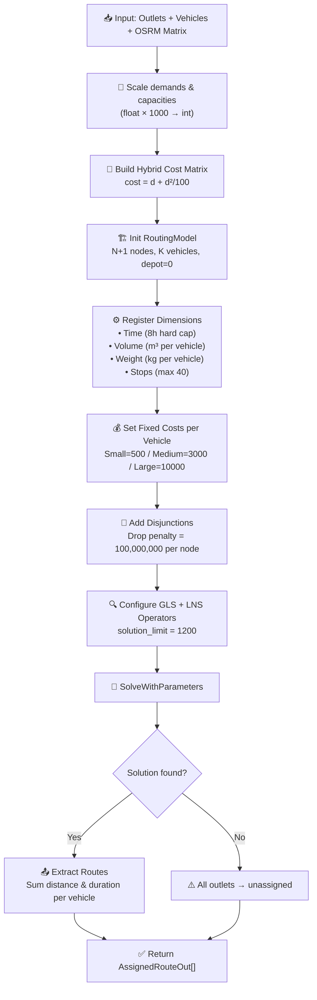
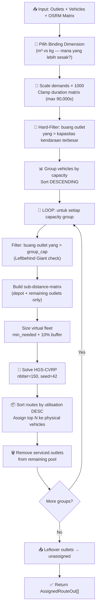

# Technical Architecture — CVRP Routing Engine

> **Source:** `cvrp_service.py` — FastAPI backend service.
> Dokumen ini menjelaskan arsitektur teknis routing engine secara end-to-end,
> dari input data sampai output rute optimal. Ditulis untuk developer dan
> manager yang ingin memahami bagaimana sistem bekerja di balik layar.

---

## 1. Basic Concepts (Pengenalan Teknologi)

### CVRP — Capacitated Vehicle Routing Problem

Bayangkan kamu punya 1 gudang (depot) dan 200 toko (outlets) yang harus
dikirim hari ini. Kamu punya 15 kendaraan, masing-masing punya batas
kapasitas kubikasi (m³) dan tonase (kg). CVRP adalah masalah optimasi:
**bagaimana membagi 200 toko ke 15 kendaraan, dengan urutan kunjungan
yang paling efisien, tanpa melebihi kapasitas masing-masing kendaraan?**

### Heterogeneous Fleet (Armada Campuran)

Armada kita bukan satu jenis — ada motor, L300, Engkel, dll. Masing-masing
punya kapasitas berbeda. Ini bikin masalah jauh lebih kompleks daripada
CVRP standar yang pakai kendaraan identik.

### OSRM — Open Source Routing Machine

OSRM adalah server peta jalan yang di-host sendiri (self-hosted). Fungsinya:
diberikan koordinat GPS toko-toko, OSRM menghitung **jarak tempuh (meter)**
dan **waktu tempuh (detik)** antar semua pasangan titik via jalan raya
sesungguhnya (bukan garis lurus). Hasilnya berupa matriks N×N.

### OR-Tools + GLS (Guided Local Search)

Google OR-Tools adalah solver optimasi dari Google. GLS adalah metode
pencarian lokal yang "pintar" — ketika solver terjebak di solusi yang
sudah tidak bisa diperbaiki lagi (local optimum), GLS menambahkan penalty
di rute-rute yang sering dipakai, memaksa solver untuk coba jalur baru.

Analoginya: seperti GPS Waze yang sengaja coba jalan alternatif ketika
jalan utama selalu macet.

### HGS — Hybrid Genetic Search

HGS-CVRP (PyHygese) adalah algoritma state-of-the-art dari dunia riset
akademik. Cara kerjanya mirip "seleksi alam" — buat populasi solusi acak,
kawinkan (crossover) solusi-solusi terbaik, mutasi hasilnya, buang yang
jelek, ulangi. Setelah ratusan generasi, solusi yang survive biasanya
sangat bagus.

Kelemahan: HGS hanya support **satu jenis kapasitas** (homogeneous fleet).
Makanya kita perlu strategi khusus untuk armada campuran (lihat §4).

---

## 2. System Pre-Processing & OSRM Integration

### 2.1 Input: Apa yang dikirim frontend?

Frontend mengirim POST request ke `/optimize` dengan payload seperti ini:

```json
{
  "depot": { "lat": -6.163011, "lng": 106.691112 },
  "outlets": [
    { "id": "CUST001", "lat": -6.200, "lng": 106.816, "m3": 0.25, "kg": 15.0, "custname": "Toko A" },
    { "id": "CUST002", "lat": -6.175, "lng": 106.845, "m3": 1.80, "kg": 120.0, "custname": "Toko B" },
    { "id": "CUST003", "lat": -6.230, "lng": 106.750, "m3": 0.05, "kg": 3.5, "custname": "Toko C" }
  ],
  "vehicles": [
    { "id": "B1234XY", "max_m3": 2.0, "max_kg": 500.0, "jns_kend": "L300" },
    { "id": "B5678AB", "max_m3": 8.0, "max_kg": 3000.0, "jns_kend": "Engkel" }
  ],
  "algorithm": "ortools",
  "max_stops": 40
}
```

### 2.2 OSRM Matrix Fetch

Sistem menggabungkan koordinat depot + semua outlet, lalu panggil OSRM
Table API **sekali saja** untuk dapat matriks durasi DAN jarak:

```
GET http://20.187.66.251:5000/table/v1/driving/
  106.691112,-6.163011;106.816,-6.200;106.845,-6.175;106.750,-6.230
  ?annotations=duration,distance
```

Kalau URL-nya lebih dari 4.000 karakter (1.000+ outlet), sistem otomatis
switch ke GET dengan query params supaya tidak kena HTTP 414 (URL Too Long).

**Response OSRM** (matriks 4×4 untuk contoh 3 outlet + 1 depot):

```json
{
  "code": "Ok",
  "durations": [
    [0.0,   1200.5, 980.3,  1500.0],
    [1210.0, 0.0,   450.2,  1800.0],
    [990.0,  440.0, 0.0,    1350.0],
    [1480.0, 1790.0, 1340.0, 0.0  ]
  ],
  "distances": [
    [0.0,    15230.0, 12500.0, 18900.0],
    [15400.0, 0.0,    5600.0,  22100.0],
    [12600.0, 5500.0, 0.0,     16800.0],
    [19000.0, 22000.0, 16700.0, 0.0   ]
  ]
}
```

- `durations[i][j]` = waktu tempuh dari titik i ke titik j (**detik**)
- `distances[i][j]` = jarak tempuh dari titik i ke titik j (**meter**)
- Index 0 = depot, index 1..N = outlet sesuai urutan payload

### 2.3 Demand Scaling: Float ke Integer

OR-Tools dan HGS butuh angka bulat (integer). Demand outlet dan kapasitas
kendaraan di-scale dengan faktor **1000** supaya presisi 3 desimal tetap
terjaga:

```
DEMAND_SCALE = 1000

# Contoh outlet: m3 = 0.25, kg = 15.0
# Setelah scaling:
m3_demand = round(0.25 × 1000) = 250
kg_demand = round(15.0 × 1000) = 15000

# Contoh vehicle: max_m3 = 2.0, max_kg = 500.0
# Setelah scaling:
m3_cap = round(2.0 × 1000) = 2000
kg_cap = round(500.0 × 1000) = 500000
```

### 2.4 Binding Dimension (Khusus HGS)

HGS cuma bisa handle satu jenis kapasitas. Jadi sistem harus pilih:
**pakai m³ atau kg?** Caranya: hitung "load ratio" masing-masing dimensi.

```
Contoh:
  Total demand m³ = 45.0,  Total fleet m³ cap = 50.0  → m3_load = 45/50 = 0.90
  Total demand kg = 2800,  Total fleet kg cap = 8000   → kg_load = 2800/8000 = 0.35

  Karena m3_load (0.90) > kg_load (0.35), m³ jadi "binding dimension".
  → Semua perhitungan HGS pakai m³ sebagai constraint kapasitas.
```

Dimensi dengan load ratio lebih tinggi artinya "lebih sesak" — lebih
rawan over-capacity. Itulah dimensi yang harus dijaga ketat.

---

## 3. OR-Tools (GLS) End-to-End Pipeline

### 3.1 Pipeline Overview



### 3.2 Step-by-Step

#### Step 1 — Build Hybrid Cost Matrix

Ini kunci anti-"spaghetti route". Sistem TIDAK pakai durasi mentah sebagai
cost. Sebaliknya, setiap edge (i→j) diberi biaya:

```
cost(i,j) = d + d²/100

dimana d = durasi dalam detik (integer)
```

Efeknya: jarak dekat hampir gratis, tapi jarak jauh **sangat mahal** secara
kuadratik. Ini memaksa solver bikin rute berbentuk "kelopak bunga" (petal)
— kendaraan hanya serve area lokal, tidak lompat lintas kota.

```
Contoh dampak quadratic cost:

  d =   60s (1 menit, nearby)    → cost =   60 +      36 =       96   ← murah
  d =  300s (5 menit, dekat)     → cost =  300 +     900 =    1,200
  d =  900s (15 menit, sedang)   → cost =  900 +   8,100 =    9,000
  d = 1800s (30 menit, jauh)     → cost = 1800 +  32,400 =   34,200   ← mahal!
  d = 3600s (1 jam, lintas kota) → cost = 3600 + 129,600 =  133,200   ← mustahil
```

#### Step 2 — Register 4 Dimensions (Hard Constraints)

| Dimension | Fungsi | Batas |
|---|---|---|
| **Time** | Hard cap waktu per kendaraan | ≤ 28,800 detik (8 jam) |
| **Volume** | Kapasitas m³ per kendaraan | Beda-beda (heterogeneous) |
| **Weight** | Kapasitas kg per kendaraan | Beda-beda (heterogeneous) |
| **Stops** | Max outlet per kendaraan | Default 40 (configurable 1-500) |

**Penting:** Time dimension pakai durasi mentah (bukan hybrid cost). 
Hybrid cost hanya dipakai sebagai "harga" edge, bukan sebagai waktu
sebenarnya.

#### Step 3 — Dynamic Fixed Cost per Vehicle

Supaya solver lebih suka pakai motor untuk kirim 1 karton ke toko kecil
(bukan kirim Engkel), setiap kendaraan punya "biaya aktivasi":

```
if max_m3 ≤ 1.0:   fixed_cost =    500   # Motor/Demo
if max_m3 ≤ 5.0:   fixed_cost =  3,000   # L300 / Van kecil
if max_m3 > 5.0:   fixed_cost = 10,000   # Engkel / Truck besar
```

Solver akan menghindari pakai kendaraan besar kalau kendaraan kecil sudah
cukup — karena biaya aktivasinya 20× lebih murah.

#### Step 4 — Disjunctions (Boleh Drop Node)

Setiap outlet dibungkus "disjunction" dengan penalty **100,000,000**.
Artinya: solver BOLEH skip outlet, tapi harganya sangat mahal. Jadi
solver akan berusaha mati-matian untuk assign semua outlet, dan hanya
drop kalau benar-benar tidak ada kendaraan yang bisa muat.

#### Step 5 — Search Parameters

```python
# Strategi awal: sisipkan outlet termurah ke posisi termurah di semua kendaraan
first_solution_strategy = PARALLEL_CHEAPEST_INSERTION

# Metaheuristic: Guided Local Search
local_search_metaheuristic = GUIDED_LOCAL_SEARCH

# Termination: stop setelah 1200 improving solutions (± 50 detik)
solution_limit = 1200

# LNS Operators (Large Neighborhood Search):
# Relocate, Exchange, Cross-Exchange, Or-Opt, TSP-Opt, Relocate-Neighbors
```

**Kenapa `solution_limit` bukan `time_limit`?**

`time_limit` bergantung pada kecepatan CPU saat itu — kalau server lagi sibuk,
hasilnya bisa beda. `solution_limit` bikin hasil **deterministik**: berapa
pun beban CPU, solver selalu berhenti setelah jumlah solusi yang sama.

Kalibrasi: 500 solutions selesai dalam ±21 detik → 1200 solutions ≈ 50 detik.

**Kenapa tidak pakai `random_seed`?**

Field `random_seed` tidak di-expose di protobuf OR-Tools build yang kita
pakai. Set field ini akan crash (`AttributeError`). `solution_limit` sendiri
sudah cukup untuk reproducibility.

### 3.3 Route Extraction

Setelah solver selesai, sistem traverse setiap kendaraan dari start ke end,
kumpulkan node-node non-depot:

```
Contoh route_nodes untuk Vehicle B1234XY: [3, 1, 7, 12]
→ Berarti kendaraan ini mengunjungi outlet ke-3, ke-1, ke-7, ke-12 (urut)

Route sequence lengkap (termasuk depot): [0, 3, 1, 7, 12, 0]
→ Total durasi = dur[0→3] + dur[3→1] + dur[1→7] + dur[7→12] + dur[12→0]
→ Total jarak  = dist[0→3] + dist[3→1] + dist[1→7] + dist[7→12] + dist[12→0]
```

---

## 4. HGS-CVRP Sequential Routing End-to-End Pipeline

### 4.1 Pipeline Overview



### 4.2 Step-by-Step

#### Step 1 — Hard-Filter Impossible Outlets

Sebelum masuk loop, sistem langsung buang outlet yang demand-nya melebihi
kendaraan TERBESAR di seluruh armada:

```
max_scaled_cap = max kapasitas seluruh fleet (dalam binding dimension)

Contoh:
  Fleet terbesar: Engkel, max_m3 = 8.0 → scaled = 8000
  Outlet CUST099: m3 = 9.5 → scaled = 9500

  9500 > 8000 → CUST099 langsung masuk impossible_ids (unassigned)
```

#### Step 2 — Group & Sort Vehicles

Kendaraan di-group berdasarkan kapasitas (binding dimension), lalu
diurutkan dari **terbesar ke terkecil**:

```
Contoh fleet: 2 Engkel (8m³), 3 L300 (2m³), 1 Motor (0.5m³)

Groups (sorted DESC):
  Group 1: cap=8000, vehicles=[Engkel_A, Engkel_B]
  Group 2: cap=2000, vehicles=[L300_A, L300_B, L300_C]
  Group 3: cap=500,  vehicles=[Motor_A]
```

#### Step 3 — Sequential Loop (per Group)

Untuk setiap group, dari yang terbesar:

**3a. Feasibility Filter (Leftbehind Giant Check)**

```python
feasible = [i for i in remaining if outlet_scaled_demands[i] <= group_cap]
overflow = [i for i in remaining if outlet_scaled_demands[i] > group_cap]
```

Outlet yang demand-nya melebihi `group_cap` langsung di-drop ke
`impossible_ids`. Karena groups diproses dari besar ke kecil, kalau
outlet sudah tidak muat di group ini, dia PASTI tidak muat di group
berikutnya yang lebih kecil.

**Ini adalah mekanisme "Leftbehind Giant":**

```
Skenario:
  Group 1 (Engkel, cap=8000): 50 outlet tersedia.
  HGS solve → assign 45 outlet ke 2 Engkel.
  5 outlet tersisa di remaining pool.

  Group 2 (L300, cap=2000): cek 5 outlet tersisa.
  Outlet CUST050: demand=3500 → 3500 > 2000 → DROPPED!

  CUST050 sebenarnya muat di Engkel (3500 < 8000), tapi karena
  HGS memilih outlet lain yang total distance-nya lebih efisien,
  CUST050 terlewat. Sekarang sudah tidak ada kendaraan yang cukup
  besar → permanent unassigned.
```

**3b. Build Sub-Problem**

Sistem bikin matriks jarak BARU yang hanya berisi depot + outlet yang
masih tersisa. Kalau awalnya 200 outlet, tapi setelah Group 1 tinggal
50, maka matriks jadi 51×51 (bukan 201×201).

**3c. Virtual Fleet Sizing**

HGS butuh tahu "berapa kendaraan virtual" yang tersedia. Rumusnya:

```
min_needed = ceil(total_remaining_demand / group_cap)
virtual_fleet = min(200, max(n_physical, min_needed) + max(2, ceil(min_needed × 0.10)))

Contoh:
  Total demand remaining = 15000, group_cap = 2000
  min_needed = ceil(15000/2000) = 8
  n_physical = 3 (L300)
  virtual = min(200, max(3, 8) + max(2, ceil(0.8))) = min(200, 8+2) = 10

  → HGS diizinkan pakai sampai 10 kendaraan virtual
```

Buffer 10% (minimum 2) memberikan HGS ruang eksplorasi lebih luas
daripada minimum teoretis.

**3d. Solve & Assign**

```python
ap = hgs.AlgorithmParameters(nbIter=150, seed=42)
solver = hgs.Solver(parameters=ap, verbose=True)
result = solver.solve_cvrp(data)
```

Setelah solve, routes diurutkan berdasarkan total demand (descending).
Top-N routes (N = jumlah physical vehicle di group ini) di-assign ke
kendaraan fisik. Sisanya dibuang (akan diambil oleh group berikutnya
kalau muat).

### 4.3 Constants & Parameters

| Parameter | Nilai | Penjelasan |
|---|---|---|
| `HGS_NB_ITER` | **150** | Iterasi genetik per group. Kalibrasi: 2500 iter butuh >400 detik; 150 iter ≈ 60 detik total. |
| `HGS_SEED` | **42** | Fixed random seed — hasil reproducible. |
| `HGS_SCALE` | **1000** | Float → integer scaling (sama dengan OR-Tools). |
| `HGS_DIST_CAP` | **90,000** | Clamp durasi OSRM ke max 90,000 detik (25 jam) untuk stabilitas HGS. |
| `HGS_MAX_FLEET` | **200** | Batas atas jumlah virtual vehicles per solve call. |
| Virtual fleet buffer | **+10% (min 2)** | Memberi HGS ruang eksplorasi di atas minimum teoretis. |

### 4.4 Kenapa Loop dari Besar ke Kecil?

Karena kendaraan besar bisa serve outlet besar DAN kecil. Kalau kita mulai
dari yang kecil, outlet besar tidak akan pernah ter-serve. Dengan mulai dari
Engkel → L300 → Motor, kita pastikan outlet-outlet besar di-handle duluan
oleh kendaraan yang mampu.

### 4.5 Perbandingan Singkat: OR-Tools vs HGS

| Aspek | OR-Tools (GLS) | HGS (Sequential) |
|---|---|---|
| Fleet handling | Native heterogeneous | Sequential homogeneous loop |
| Kapasitas | m³ + kg sekaligus | Hanya 1 binding dimension |
| Max stops | ✅ Enforced | ❌ Not enforced |
| Max time/vehicle | ✅ 8 jam hard cap | ❌ Tidak ada |
| Quadratic arc cost | ✅ d + d²/100 | ❌ Pakai durasi mentah |
| Fixed vehicle cost | ✅ Tiered 500/3000/10000 | ❌ Tidak ada |
| Termination | 1200 improving solutions | 150 genetic iterations/group |
| Reproducibility | `solution_limit` | `seed=42` + fixed `nbIter` |
